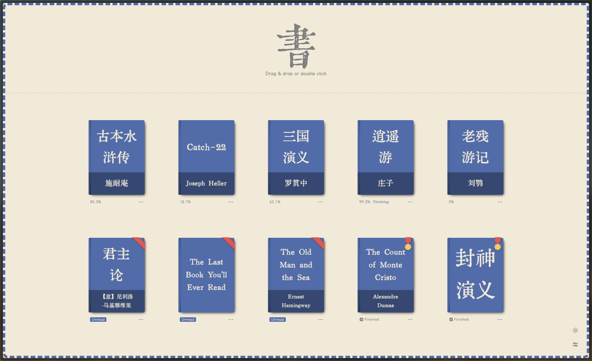

> 2026-11-11 重构：Web 为主线；本地设置文件替代 textdb，单一离线 OpenCC 开关。新导入书籍使用独立 ID，同名书不覆盖，缓存保留原文。更改转换开关后重新打开书籍生效。构建不再自动打包 books/；`pnpm run preprocess-books` 仅为显式离线工具。实施与限制见 [重构记录](docs/DEV-REFACTOR-PLAN-2026-11-11.md)。
<!-- markdownlint-disable MD033 MD041 -->
<div align="center">

<a href="https://reader.yijian.app" target="_blank">
    
</a>

<br/>

<a href="https://opensource.org/licenses/MIT" target="_blank">
    
</a>

<br/><br/>

<a href="README.md">中文</a> | <a href="README_EN.md">English</a>

</div>

SimpleTextReader is a clean, elegant TXT/EPUB reader that enhances plain text books with a refined reading experience.

This project is based on [henryxrl/SimpleTextReader](https://github.com/henryxrl/SimpleTextReader) (original) and [cataerogong/SimpleTextReader](https://github.com/cataerogong/SimpleTextReader) (enhanced fork), combining features from both and adding EPUB support.



## Feature Origins

Features in this project come from three sources:

### Original Features (henryxrl)

Core features from [henryxrl/SimpleTextReader](https://github.com/henryxrl/SimpleTextReader):

1. Instant large file opening with automatic encoding detection
2. Auto detection of book title and author name (`《书名》作者：作者名.txt`, `Bookname by author.txt`, etc.)
3. Automatic chapter title detection via regex; manual marking with `[::]`
4. Auto extraction of footnotes (① to ㊿)
5. UI language auto-switches based on file content (Chinese/English)
6. Automatic ad removal from text
7. Auto-generated title page with book seal stamp
8. Reading progress saved automatically (per-line precision)
9. Bookshelf with auto-generated cover art
10. Up to 3 custom fonts (TTF/OTF)
11. Twelve web fonts (requires internet)
12. Dark mode, PWA support
13. Infinite scroll mode (scroll past top/bottom edge to turn page)
14. Settings menu (font size, line height, theme color, etc.)
15. Browser history navigation

**Browser extensions** (Chrome / Firefox / Edge) are published by henryxrl, version v1.6.9.5:

This fork publishes the Web reader. Legacy extension tooling remains available for local compatibility checks.

- [Chrome Extension](https://chrome.google.com/webstore/detail/%E6%98%93%E7%AC%BA/dbanahlbopbjpgdkecmclbbonhpohcaf)
- [Firefox Extension](https://addons.mozilla.org/en-US/firefox/addon/yijian/)
- [Edge Extension](https://microsoftedge.microsoft.com/addons/detail/pabihehbdhldbdliffaddllmjlknmpak)

### Enhanced Features (cataerogong)

Enhancements from [cataerogong/SimpleTextReader](https://github.com/cataerogong/SimpleTextReader):

1. **分页阅读 / Paginated reading**：保留滚轮翻页；实验性自动拼接已退役。
2. **Full-Text Search**: Regex-enabled search dialog with forward/backward navigation and match highlighting. Shortcut: `F`.
3. **Quick Jump (Go to Line)**: Jump by line number or percentage. Shortcut: `G`.
4. **Log Mode**: Simplified rendering for `.log` files — preserves blank lines and indentation, skips title detection and text optimization, and renders at most 500 physical lines per page.
5. **Progress Bar**: Vertical slider in the sidebar for quick navigation. Works with paginated reading.
6. **Line Number Display**: `data-line-num` attribute on all content elements, toggled via settings.
7. **Reader Mode Setting**: Auto / Book / Log modes.

### New Features in This Project

Added by this repository (sixiang-world):

1. **EPUB Format Support**: JSZip decompression + OPF parsing + XHTML-to-structure conversion, feeding EPUB content into the existing TXT rendering pipeline. All TXT reading features (pagination, TOC, dark mode, fonts, bookshelf, progress) work automatically for EPUB files.
2. **EPUB Chapter-Based Pagination**: Spine-based chapter-level pagination replacing single-page rendering.
3. **EPUB TOC Mapping**: NCX/TOC entries mapped to line numbers for sidebar chapter navigation.
4. **EPUB Bookshelf Persistence**: EPUB files saved to bookshelf with progress restore on reopen.
5. **EPUB Language Detection**: Automatic language detection with UI language switching.
6. **Infinite Scroll Fix**: Original `isActivelyScrolling` check required `deltaY < 20` for 3 consecutive events — impossible with normal mouse wheels. Replaced with a 300ms idle timeout: page turns automatically after the user stops scrolling.
7. **Easier Infinite Scrolling**: Reduces the page-turn threshold (1200 → 400). **Recommended for use together with Infinite Scroll** for smoother page turns.
8. **Anonymous Mode**: When enabled, opened books won't appear on the bookshelf — useful for quick one-off reads.
9. **Show Book Title Toggle**: Hides the book name from the browser tab title, always showing "易笺" instead.

### Recommended Page-Turn Settings

> **Recommended: Enable both "Infinite Scroll" and "Easier Infinite Scrolling"** — the combination provides the smoothest page-turn experience.
> Auto-Join 已退役；滚轮翻页仍保留。

## Usage

### Add Books

Drag and drop **TXT or EPUB files** into the interface, or double-click to select files. A single book opens immediately. Selecting multiple files saves the books to the bookshelf for later reading. Batch import requires the bookshelf to be enabled and Anonymous Mode to be off.

### Bookshelf Management

- Click a cover to open a book
- **Alt/Option + click** to force reprocess
- Filter bar at top for filtering; supports batch or individual deletion

### Reading Features

- Left sidebar TOC for chapter navigation
- **Arrow keys** to turn pages, or enable Infinite Scroll mode (recommended: also enable Easier Infinite Scrolling for smoother turns)
- **Page Up / Page Down** to jump between chapters
- **F** for full-text search, **G** for quick jump
- **Esc** to return to bookshelf

### Advanced Usage (Modifying TXT Source File)

#### Manually Marking Titles

Add `[::]` at the beginning of a line to designate it as a title:

```txt
[::] I am a chapter title!
```

#### Using Footnotes

Insert ① to ㊿ to reference footnotes. Footnote lines start with the corresponding symbol:

```txt
In the Northern Ocean①, there is a fish called Kun②.
① Northern Ocean: A vast sea, named for its deep and dark waters.
② Kun (kūn): Originally meant "fish fry," here used to mean a giant fish.
```

## Docker

```bash
# Basic
docker run -d --name simpletextreader \
-p 8866:8866 \
--restart unless-stopped \
henryxrl/simpletextreader:latest

# With library directory
docker run -d --name simpletextreader \
-p 8866:8866 \
-v /path/to/your/books:/app/books \
--restart unless-stopped \
henryxrl/simpletextreader:latest
```

## URL Parameters (Debug)

Append `?param` to the URL; use `&` for multiple parameters:

| Parameter | Description |
|---|---|
| `no-bookshelf` | Disable bookshelf |
| `no-settings` | Disable settings menu |
| `no-fast-open` | Disable fast open (wait for full processing) |
| `no-pagebreak-on-title` | Page break by line count instead of chapters |
| `always-process` | Force reprocess on every open |
| `print-db` | Print database contents |
| `upgrade-db` | Manually upgrade database |

---

## Development

This project uses **Vite** for building and **pnpm** as the package manager.

```bash
# Install dependencies
pnpm install

# Start dev server (default port 3000)
pnpm run dev

# Production build (outputs to dist/)
pnpm run build

# Run all unit tests (22 test files)
pnpm run test
```

### Project Structure (v2 Refactor)

```
client/
  src/                      # Source code (ES modules)
    app.js                  # Application entry point
    init-webpage.js         # Page initialization (language/theme/SVG icons)
    config/                 # Constants, runtime variables, Schema
    core/                   # Presets, settings files, and other core logic
    components/             # Reusable UI components
    modules/
      reader/               # Reader core (pagination, footnotes, search, navigation)
      bookshelf/            # Bookshelf management
      settings/             # Settings (state management + Schema + font baseline)
      font/                 # Font pool
      file/                 # File handling & encoding detection
      text/                 # Text processing
      database/             # IndexedDB storage
      epub/                 # EPUB parsing & conversion
    utils/                  # Utility functions
      base/                 # Core utilities (color, DOM, format, path, etc.)
      helpers/              # Feature-specific helpers
    styles/                 # CSS (variables.css, main.css, reader.css, etc.)
  lib/                      # Third-party libraries (jQuery, tippy, JSZip, jschardet…)
  fonts/                    # Font files
  images/                   # Image assets
  manifests/                # Extension manifests (Chrome / Firefox / PWA)
shared/                     # Shared core logic (client/server-agnostic)
archive/                    # Historical code archives (server/, debug/, etc.)
test/                       # Unit tests (22 test files, Node-native assert)
```

## v1 → v2 migration guide (breaking changes)

This release line (since v2.0.0) is a major refactor and is **not backward compatible with v1**. Read the following before upgrading:

1. **Server-side is deprecated**: the old `server/` (Node + Express + Prisma, including `/api/library/*`, `/api/auth/*`, login and the bookshelf database) is archived under `archive/server/`. **The v2 image is a static frontend only** (Vite build output), served by Caddy or any static server. There is **no migration script** for server-stored bookshelves — re-import your books after upgrading.
2. **Local settings files**: export/import JSON preferences. The retired textdb service is no longer contacted. Files do not contain books, fonts or old sync tokens.
3. **Sync data format v2 (not backward compatible)**: the format is now `{_meta:{v:2}, key:{v,ts}}` with field-level timestamps, incompatible with the flat 1.x format. **Upgrade all devices to ≥2.0.0**, otherwise old clients fail to read v2 data.
4. **`isOnServer` is deprecated**: the client no longer has the concept of "book stored on server"; legacy data fields remain for compatibility; the current application has no server library.

Upgrade tip: rebuild the image (don't blindly overwrite an incompatible environment with the old `:latest`), and back up local books before upgrading.

---

### This project is only for personal use and learning purposes, not for commercial use.
